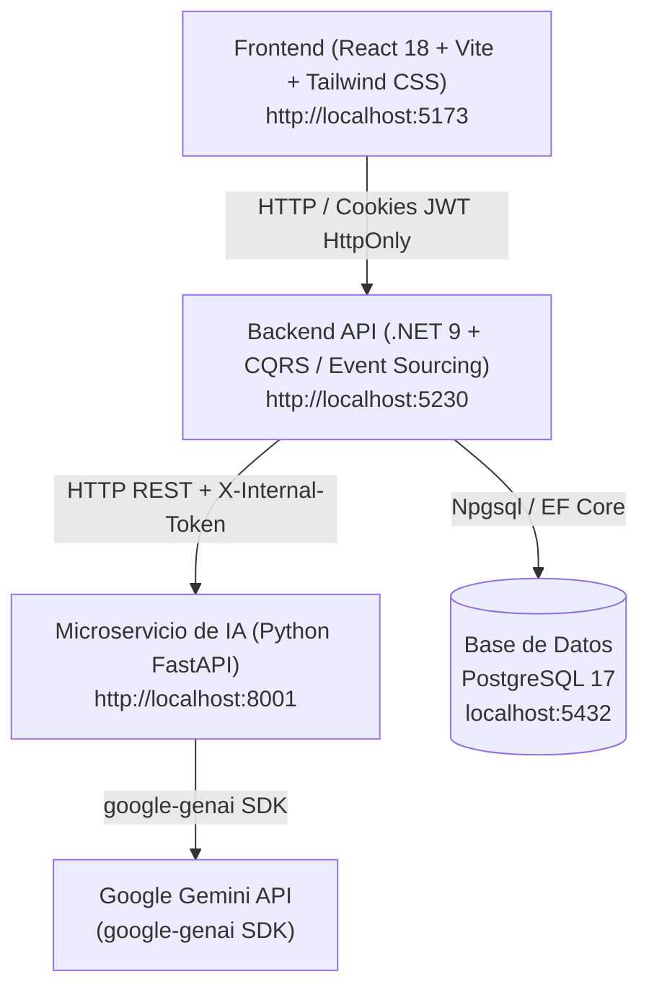

# Plataforma de Gamificación Educativa con IA — PFC

Sistema web de gamificación educativa con generación de contenido asistida por IA bajo un esquema **HITL** (*Human-in-the-Loop*): la IA propone, el docente decide y ajusta. Desarrollado como Proyecto Final de Carrera (Licenciatura en Sistemas de Información, FaCENA-UNNE).

---

## 🏛️ Arquitectura del Sistema

El sistema implementa una arquitectura desacoplada basada en microservicios, CQRS y Event Sourcing:



| Capa | Tecnologías | Responsabilidad |
|------|-------------|-----------------|
| **Frontend** | React 18, Vite, Tailwind CSS v4, React Query, Zustand, Lucide Icons, Canvas Confetti | UI/UX interactiva con estética *Painterly RPG*, modo claro/oscuro y consumo CQRS |
| **Backend** | .NET 9 WebAPI, EF Core, Npgsql, MediatR (CQRS), Event Sourcing | Lógica de agregados de dominio, persistencia de eventos, proyecciones y endpoints REST |
| **Microservicio IA** | Python 3.11+, FastAPI, Uvicorn, SDK oficial `google-genai` | Generación estructurada de misiones y mini-juegos mediante modelos Gemini |
| **Persistencia** | PostgreSQL 17 en Docker Compose | Almacén relacional de eventos (`Eventos`), proyecciones (`PersonajesResumen`, `MisionesActivas`, etc.) |

---

## 🎮 Tipos de Misiones y Mini-juegos

1. **Opción Múltiple Interactiva**:
   * Cuestionarios dinámicos con retroalimentación inmediata y explicaciones pedagógicas.
   * Sistema de recompensa calibrada en XP (Experiencia) y AP (Puntos de Aventura).

2. **Batalla de Jefe (Boss Fight)**:
   * Encuentros épicos por fases contra jefes temáticos (ej. *El Bug Ancestral*).
   * Barra de HP sincronizada, efectos visuales de daño/fallo y resolución táctica de preguntas clave.

3. **Línea Temporal (Secuencia Histórica / Sistemas)**:
   * Reconstrucción cronológica interactiva mediante ordenamiento de eventos y acusación del detonante/evento culpable.

---

## 🛡️ Características Principales

* **Flujo HITL (Human-in-the-Loop)**:
  * Generación automática de misiones con estimación de confianza IA (0% a 100%).
  * El docente puede inspeccionar, probar mediante un simulador en tiempo real, editar preguntas/recompensas o descartar antes de publicar en el aula.
* **Importación y Exportación Modular**:
  * Importación/exportación de misiones en formato JSON estructurado entre aulas y docentes.
* **Personalización de Identidad y Bazar de Cosméticos**:
  * **Avatares temáticos**: Ilustraciones de cuerpo entero e iconos de busto (Guerrero, Hechicero Arcano, Sanadora de la Luz, Paladín, Nigromante, etc.).
  * **Marcos de Avatar**: Marcos orlados, filigranas y runas con adaptación física al contorno en todos los componentes.
  * **Títulos Honoríficos**: Desbloqueables por nivel alcanzado y hitos académicos.
  * **Mascotas acompañantes**: Compañeros de aventura (Dragón, Fénix, etc.).
* **Salón de Aventureros (Leaderboard)**:
  * Vista responsive del aula con clasificación en tiempo real por XP y nivel.
  * Visualización completa de los personajes de los compañeros con sus cosméticos equipados.
* **Métricas y Secuencia Curricular**:
  * Panel docente de analítica con tasas de aprobación, dificultad percibida y seguimiento por alumno.
* **Seguridad y Gestión de Cuenta**:
  * Autenticación basada en cookies JWT `HttpOnly` y `SameSite`.
  * Cambio seguro de contraseña con validación de credencial actual.
  * Baja de cuenta con confirmación destructiva y desvinculación completa.

---

## 📋 Requisitos Previos

1. **Docker Desktop** (o Docker Engine + Docker Compose v2+)
2. **.NET 9 SDK** — [descargar](https://dotnet.microsoft.com/download/dotnet/9.0)
3. **Node.js v18+** con `npm` — [descargar](https://nodejs.org/)
4. **Python 3.11+** — [descargar](https://www.python.org/)
5. **API Key de Google Gemini** — obtenible en [Google AI Studio](https://aistudio.google.com/)
6. Herramienta global de migraciones:
   ```bash
   dotnet tool install --global dotnet-ef
   ```

---

## 🚀 Guía de Instalación y Puesta en Marcha

### 1. Variables de Entorno

```bash
# Variables del entorno raíz (PostgreSQL)
cp .env.example .env

# Microservicio de IA
cp ai-service/.env.example ai-service/.env
# Editar ai-service/.env con tu GEMINI_API_KEY y un TOKEN_INTERNO_BACKEND seguro.

# Backend .NET
cp backend/WebApi/appsettings.Development.json.example backend/WebApi/appsettings.Development.json
# Asegurarse de que AiService:TokenInterno coincida con el TOKEN_INTERNO_BACKEND configurado en Python.
```

Configurar el secreto JWT en el almacén seguro de .NET (no versionado):

```bash
cd backend/WebApi
dotnet user-secrets init
dotnet user-secrets set "JwtSettings:Secret" "un-string-aleatorio-largo-y-seguro-para-jwt-firma-local"
cd ../..
```

### 2. Base de Datos (Docker)

```bash
docker compose up -d
docker compose ps   # Verificar que el contenedor esté 'healthy'
```

### 3. Aplicar Migraciones

```bash
cd backend
dotnet ef database update --project Infrastructure --startup-project WebApi
cd ..
```

### 4. Microservicio de IA (Python FastAPI)

```bash
cd ai-service
python -m venv venv

# En Windows:
.\venv\Scripts\activate
# En Linux/macOS:
source venv/bin/activate

pip install -r requirements.txt
uvicorn main:app --reload --port 8001
```

*Microservicio disponible en `http://localhost:8001`.*

### 5. Backend WebAPI (.NET 9)

```bash
cd backend/WebApi
dotnet run
```

*WebAPI iniciará en `http://localhost:5230`. En entorno `Development` se ejecutan automáticamente las semillas de prueba.*
*Documentación interactiva OpenAPI (Scalar): `http://localhost:5230/scalar`.*

### 6. Frontend (React + Vite)

```bash
cd frontend
npm install
npm run dev
```

*Aplicación disponible en `http://localhost:5173`.*

---

## 🔑 Credenciales de Prueba (Seed de Desarrollo)

Todas las cuentas de prueba tienen la contraseña predeterminada: `Cambiar123!`

| Rol | Correo Electrónico | Descripción |
|-----|-------------------|-------------|
| **Docente** | `docente@unne.edu.ar` | Acceso a Inbox HITL, Validador de Misiones, Métricas y Creación de Aulas |
| **Alumno 1** | `joel@alumno.unne.edu.ar` | Alumno inicial con misiones listas para resolver y bazar disponible |
| **Alumno 2** | `segundo.alumno@unne.edu.ar` | Alumna con nivel 2, misión resuelta y cosméticos equipados para Leaderboard |
| **Directivo** | `directivo@unne.edu.ar` | Panel institucional de métricas y supervisión de aulas |
| **Administrador** | `admin@unne.edu.ar` | Gestión de altas de usuarios y configuración de la plataforma |

---

## 🧪 Pruebas Automatizadas

### Backend (.NET)
Ejecutar la suite completa de tests de dominio y proyecciones (86 tests unitarios):
```bash
dotnet test backend/GamificacionBackend.sln
```

### Frontend (React)
Verificar la compilación estática y empaquetado de producción:
```bash
npm --prefix frontend run build
```

---

## 📁 Estructura del Repositorio

```text
GamificacionPFC/
├── ai-service/              # Microservicio Python FastAPI (generación Gemini)
├── backend/                 # Solución .NET 9 (Clean Architecture + CQRS + Event Sourcing)
│   ├── Core.Domain/         # Agregados (Personaje, Misión, Aula, Usuario), Eventos y Reglas
│   ├── Core.Application/    # Comandos, Queries, Handlers (MediatR) y Proyecciones
│   ├── Infrastructure/      # EF Core, Repositorios, PostgresDbContext y Cliente HTTP IA
│   ├── WebApi/              # Minimal APIs, Endpoints de autenticación, sesión y Scalar Docs
│   └── Core.Domain.Tests/   # Batería de 86 pruebas unitarias de dominio
├── frontend/                # SPA React 18 + Vite + Tailwind CSS v4
│   ├── src/
│   │   ├── components/      # Componentes UI reutilizables (Badge, Button, Modal, etc.)
│   │   ├── features/        # Módulos por dominio (alumno, docente, directivo, admin, auth)
│   │   ├── hooks/           # Hooks personalizados de React Query y estado
│   │   └── store/           # Stores globales de sesión y preferencias
├── .github/workflows/       # Pipelines CI/CD y análisis de seguridad (Gitleaks + CodeQL)
├── docker-compose.yml       # Orquestación de base de datos local PostgreSQL 17
└── README.md
```

---

## 📄 Licencia y Marco Académico

Proyecto académico de fin de carrera — FaCENA, Universidad Nacional del Nordeste (UNNE).  
La titularidad de los derechos patrimoniales sobre el desarrollo sigue el régimen del Art. 7 de la Res. N° 2024-615-CS.
